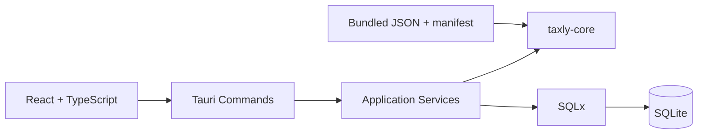

# System Architecture

Core คำนวณจาก input/rules เท่านั้น ไม่มีเวลา ระบบปฏิบัติการ ฐานข้อมูล หรือ Network การ serialize เงินเป็น string และการแปลงเป็น integer satang อยู่ที่ขอบเขต application

Application ประกอบข้อมูลทั้งปีใน read transaction; mutation เพิ่ม revision ใน transaction เดียวกัน Snapshots ตรวจ revision อีกครั้งก่อนบันทึกเพื่อปฏิเสธผลที่ข้อมูลเพิ่งเปลี่ยน

## IPC

`get_active_tax_year`, `set_active_tax_year`, `get_year_workspace`, `save_onboarding`, `save_onboarding_draft`, `save_profile`, CRUD income/deduction, `calculate_year`, `save_snapshot`, `get_history`, `get_deduction_guidance`, `get_rule_sources`, `open_source`, `export_backup`, `inspect_backup`, `restore_backup`, `cancel_restore`, `delete_all_data`

Arguments ชั้น command ใช้ camelCase ตาม Tauri; payload structs ใช้ snake_case ตาม Serde Amount เป็น decimal string, unknown withholding เป็น null ปีภายในเป็น ค.ศ. และ UI แสดง พ.ศ.

ไม่มี SQL/File/Shell APIs ให้ frontend เรียกโดยตรง ทุก command จำกัดอยู่ใน main window และไม่เปิดให้ remote origins
